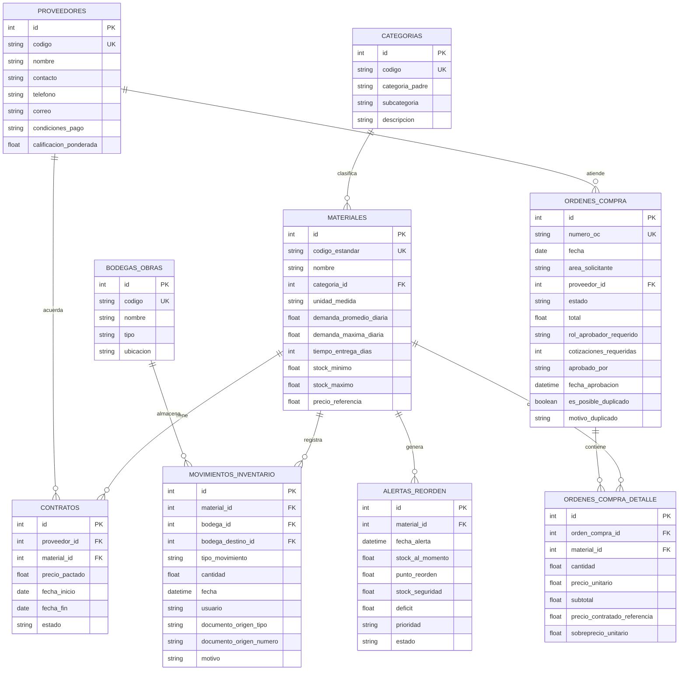

# INFORME TÉCNICO Y PRÁCTICO
## GESTIÓN DE INVENTARIOS Y CADENA DE ABASTECIMIENTO
### Quiz #2 · Trabajo Práctico Integrador

---

**Empresa de Aplicación:** Constructora Del Valle S.A.  
**Curso:** Gestión de Compras, Proveedores e Inventarios  
**Fecha de Entrega:** Viernes 6 de noviembre de 2026  
**Modalidad:** Equipos de 2 a 4 personas  

**Nombre del Equipo:** *OptiSupply Analytics & Engineering*  
**Integrantes:**  
1. ___________________________________________________________ (Carné: _____________)  
2. ___________________________________________________________ (Carné: _____________)  
3. ___________________________________________________________ (Carné: _____________)  
4. ___________________________________________________________ (Carné: _____________)  

**Tecnología Implementada:** Node.js (v24), Express, SQLite (Motor Relacional Nativo), REST API, Dashboard Web SPA, Test Runner Automatizado.

---

## 1. Resumen Ejecutivo y Propósito
El área de compras y abastecimiento representa uno de los centros donde una constructora gana o pierde rentabilidad de forma inadvertida. En proyectos civiles, los materiales directos representan entre el 50% y el 65% del costo total de obra. Las ineficiencias causadas por compras duplicadas, dispersión de proveedores (compras fuera de contrato o *maverick spend*), carencia de normalización de artículos y falta de cálculo científico del punto de reorden generan sobrecostos, mermas de capital de trabajo y parálisis operativa.

El presente informe aborda el caso integral de **Constructora Del Valle S.A.**, resolviendo con rigor analítico los ejercicios de la **Parte A (40 pts)** y desarrollando la arquitectura técnica de la **Parte B (60 pts + 10 pts extra)** mediante un sistema informático en Node.js conectado a una base de datos relacional para control de inventarios, alertas de reorden, trazabilidad por lote/OC y detección algorítmica de duplicados y fraccionamientos.

---

## 2. PARTE A: Análisis de Compras e Inventario (40 puntos)

### Ejercicio A1. El Circuito de Compra y la Matriz de Aprobación (8 pts)

#### a) Circuito Completo de Compra
El circuito de compras para Constructora Del Valle S.A. se estructura en siete etapas sucesivas, diseñadas para asegurar la segregación de funciones, la justificación presupuestaria y el control de auditoría interna.

```mermaid
flowchart TD
    A["1. Requisición Interna (RC)<br><b>Ejecuta:</b> Área solicitante (Obras/Mant)<br><b>Documento:</b> Solicitud de Requisición<br><b>Control:</b> Existencia previa en bodega y presupuesto"] --> B["2. Aprobación de Requisición<br><b>Ejecuta:</b> Jefatura según umbral<br><b>Documento:</b> RC Autorizada<br><b>Control:</b> Matriz jerárquica y no fraccionamiento"]
    B --> C["3. Cotización y Selección<br><b>Ejecuta:</b> Depto. de Compras<br><b>Documento:</b> Cuadro Comparativo / RFP<br><b>Control:</b> Cumplimiento de cotizaciones (1 a 3) y contrato marco"]
    C --> D["4. Emisión de Orden de Compra<br><b>Ejecuta:</b> Compras / Aprobador final<br><b>Documento:</b> Orden de Compra (OC)<br><b>Control:</b> Precios fijos, plazo de entrega y términos contractuales"]
    D --> E["5. Recepción Física y Técnica<br><b>Ejecuta:</b> Bodega Central / Ingeniero de Obra<br><b>Documento:</b> Informe de Recepción / Conduce sellado<br><b>Control:</b> Conteo ciego e inspección de calidad"]
    E --> F["6. Validación de Factura (Three-Way Match)<br><b>Ejecuta:</b> Contabilidad / Cuentas por Pagar<br><b>Documento:</b> Factura Electrónica (Hacienda)<br><b>Control:</b> Cruce 3 vías: OC vs Recepción vs Factura"]
    F --> G["7. Programación y Pago<br><b>Ejecuta:</b> Tesorería / Finanzas<br><b>Documento:</b> Comprobante Transferencia SINPE / Cheque<br><b>Control:</b> Plazo de crédito (30 d), descuentos pronto pago y doble firma"]
```



##### Detalle de Responsables, Documentos y Controles por Etapa:
1. **Requisición Interna:**
   - *Quién ejecuta:* Encargado de Obra, Supervisor de Mantenimiento o Bodeguero.
   - *Documento generado:* Requisición de Compra (RC) digital con foliación interna.
   - *Controles:* Verificación obligatoria de inventario existente en las demás bodegas (para evitar comprar lo que ya se tiene) y validación contra la partida presupuestaria del proyecto.
2. **Aprobación de la Requisición:**
   - *Quién ejecuta:* Jefatura correspondiente de acuerdo con la matriz de delegación de firmas.
   - *Documento generado:* Visto Bueno (Vo.Bo.) digital en ERP.
   - *Controles:* Verificación de justificación técnica y análisis de acumulación periódica para descartar fraccionamiento.
3. **Gestión de Cotizaciones y Adjudicación:**
   - *Quién ejecuta:* Comprador del Departamento de Adquisiciones.
   - *Documento generado:* Cuadro Comparativo de Ofertas y Matriz de Adjudicación.
   - *Controles:* Verificación de número de cotizaciones requeridas según el monto (1, 2 o 3 cotizaciones independientes); prioridad obligatoria a proveedores con contrato marco vigente.
4. **Emisión de la Orden de Compra (OC):**
   - *Quién ejecuta:* Jefatura de Compras y/o Gerencia respectiva.
   - *Documento generado:* Orden de Compra (OC) oficial, legalmente vinculante.
   - *Controles:* Compromiso presupuestario en el sistema, congelamiento de precios unitarios y fijación de multas por entrega tardía.
5. **Recepción Física de Bienes:**
   - *Quién ejecuta:* Bodeguero Central o Receptor en Frente de Obra.
   - *Documento generado:* Guía de Remisión firmada y Acta de Recepción en Almacén (Informe de Entrada de Material).
   - *Controles:* Conteo físico, inspección dimensional/estructural (ej. ensayos de fraguado de cemento, pruebas de fluencia en varilla) e ingreso formal al inventario del sistema.
6. **Revisión y Registro de Factura (El *Three-Way Match*):**
   - *Quién ejecuta:* Analista de Cuentas por Pagar / Contabilidad.
   - *Documento generado:* Registro contable de pasivo devengado.
   - *Control Clave:* **Three-Way Match (Cruce de Tres Vías)**. Se verifica la correspondencia unívoca entre:
     - Las cantidades y precios pactados en la **Orden de Compra**.
     - Las cantidades reales ingresadas y aceptadas en el **Informe de Recepción**.
     - Las cantidades, precios e impuestos liquidados en la **Factura Comercial**.
     *Regla:* Si existe discrepancia en cantidades o si el precio facturado supera al de la OC, el sistema bloquea el trámite hasta emitir nota de crédito o aclaración técnica.
7. **Liquidación y Pago:**
   - *Quién ejecuta:* Tesorería y Gerencia Financiera.
   - *Documento generado:* Comprobante de transferencia bancaria y recibo de cancelación.
   - *Controles:* Respeto estricto del plazo de crédito contratado (ej. 30 días), aprovechamiento de descuentos por pronto pago y autorización bancaria mancomunada (doble firma electrónica).

---

#### b) Análisis de la Matriz de Aprobación y Mitigación del Fraccionamiento

##### Matriz Propuesta Inicialmente:
| Monto de la compra (₡) | Aprueba | Cotizaciones requeridas |
| :--- | :--- | :---: |
| Hasta ₡250 000 | Jefatura del área solicitante | 1 |
| ₡250 001 a ₡2 000 000 | Jefatura de Compras | 2 |
| ₡2 000 001 a ₡10 000 000 | Gerencia Financiera | 3 |
| Más de ₡10 000 000 | Gerencia General | 3 + comité de compras |

##### Diagnóstico de Vulnerabilidad: El Riesgo de Fraccionamiento (*Smurfing* o *Splitting*)
El riesgo crítico de esta matriz radica en que **las reglas se aplican únicamente por transacción aislada**, sin control temporal ni por categoría de producto. Si un área (como Obras) necesita adquirir ₡2 580 000 en cemento (400 sacos), se ve obligada a obtener 3 cotizaciones y esperar la autorización de la Gerencia Financiera. Para eludir este control, el solicitante puede emitir deliberadamente dos órdenes separadas el mismo día (por ejemplo, OC-1041 por ₡1 290 000 y OC-1042 por ₡1 290 000). Al quedar ambas por debajo de ₡2 000 000, solo requieren 2 cotizaciones y son aprobadas de manera exprés por la Jefatura de Compras.

Consecuencias para la empresa:
- Pérdida de visibilidad gerencial sobre compras de gran escala.
- Favorecimiento indebido a proveedores particulares (*amiguismo*).
- Pérdida de bonificaciones por volumen.
- Sobrecosto administrativo al procesar múltiples órdenes pequeñas.

##### Propuesta de Mejora Integral:
1. **Regla de Acumulación Temporal por Centro de Costos y Proveedor (Ventana Móvil de 30 días):**  
   El ERP debe sumarizar todas las compras emitidas por una misma unidad solicitante a un mismo proveedor o en una misma subcategoría en un lapso de 30 días continuos. Si la sumatoria supera el umbral superior, la nueva orden exige la aprobación jerárquica del monto acumulado.
2. **Catálogos Centralizados con Precios Negociados:**  
   Para insumos estratégicos (cemento, acero, agregados), las áreas solicitantes no deben tener potestad de negociar precios ni elegir proveedores; sus requisiciones consumen contratos marco prenegociados por la Gerencia Financiera.
3. **Matriz de Aprobación Optimizada:**

| Monto de la compra (₡) | Nivel Jerárquico Requerido | Cotizaciones | Requisitos de Control Adicionales |
| :--- | :--- | :---: | :--- |
| **Hasta ₡250 000** | Jefatura del Área Solicitante | 1 | Precios validados contra catálogo de referencia. |
| **₡250 001 a ₡1 500 000** | Jefatura de Compras + Jefatura Área | 2 | Cuadro comparativo formal documentado. |
| **₡1 500 001 a ₡7 500 000** | Gerencia Financiera + Compras | 3 | Análisis de gasto acumulado trimestral. |
| **Más de ₡7 500 000** | Gerencia General + Comité de Compras | 3 | Licitación privada formal y contrato marco con póliza. |

---

### Ejercicio A2. Clasificación de Categorías de Gasto (8 pts)

#### 1. Taxonomía de Dos Niveles y Codificación Estándar
Se propone una taxonomía normalizada basada en estándares internacionales de compras (adaptación UNSPSC simplificada), asignando un código estándar alfanumérico único para cada bien físico:

| Código Estándar | Categoría Padre (Nivel 1) | Subcategoría (Nivel 2) | Descripción Normalizada del Bien | Unidad |
| :---: | :--- | :--- | :--- | :---: |
| **MAT-AGR-01** | Materiales de Construcción | Cemento y Agregados | Cemento Gris de Uso General Saco 50 kg | Saco |
| **MAT-ACE-01** | Materiales de Construcción | Acero y Metales Estructurales | Varilla Corrugada de Acero #3 (3/8" x 6 m) Grado 40 | Unidad |
| **MAT-MAM-01** | Materiales de Construcción | Mampostería y Concretos | Block de Concreto Estructural 12 x 20 x 40 cm | Unidad |
| **MAT-AGR-02** | Materiales de Construcción | Cemento y Agregados | Arena de Río para Concreto y Pegas | $m^3$ |
| **SEG-EPP-01** | Seguridad y Salud Ocupacional | Equipo de Protección Personal | Guantes de Protección de Nitrilo Talla L | Par |
| **HID-TUB-01** | Instalaciones Hidráulicas | Tuberías y Accesorios PVC | Tubo de PVC Presión 1/2" SDR 13.5 (6 m) | Tubo |

#### 2. Reclasificación de las 8 Líneas del ERP
A continuación se reclasifican las compras registradas en el ERP, agrupando los insumos homólogos que fueron solicitados bajo descripciones inconsistentes:

| # | Descripción Original en ERP | Área | Proveedor | Cant. | Precio Unit. (₡) | Total Pagado (₡) | Código Normalizado | Insumo Homólogo Identificado |
| :-: | :--- | :--- | :---: | :-: | :-: | :-: | :---: | :--- |
| **1** | Cemento gris 50 kg | Obras | Prov. A | 200 | ₡6 450 | ₡1 290 000 | **MAT-AGR-01** | **Insumo Idéntico Cemento (Líneas 1, 2 y 3)** |
| **2** | Saco cemento uso general | Mantenimiento | Prov. B | 40 | ₡7 100 | ₡284 000 | **MAT-AGR-01** | **Insumo Idéntico Cemento (Líneas 1, 2 y 3)** |
| **3** | CEM-GRIS-50 | Bodega Central | Prov. A | 300 | ₡6 300 | ₡1 890 000 | **MAT-AGR-01** | **Insumo Idéntico Cemento (Líneas 1, 2 y 3)** |
| **4** | Varilla #3 grado 40 | Obras | Prov. C | 500 | ₡2 150 | ₡1 075 000 | **MAT-ACE-01** | **Insumo Idéntico Varilla (Líneas 4 y 5)\*** |
| **5** | Hierro 3/8 x 6 m | Mantenimiento | Prov. D | 60 | ₡2 600 | ₡156 000 | **MAT-ACE-01** | **Insumo Idéntico Varilla (Líneas 4 y 5)\*** |
| **6** | Guantes de nitrilo talla L | Bodega Central | Prov. E | 100 | ₡850 | ₡85 000 | **SEG-EPP-01** | Insumo EPP (Guante Nitrilo) |
| **7** | Guantes trabajo L | Obras | Prov. F | 80 | ₡1 200 | ₡96 000 | **SEG-EPP-01** | Insumo EPP similar / genérico |
| **8** | Tubo PVC 1/2 SDR 13.5 | Mantenimiento | Prov. B | 25 | ₡2 900 | ₡72 500 | **HID-TUB-01** | Tubería Hidráulica PVC |

*\*Nota Técnica de Ingeniería Civil:* En Costa Rica, la denominación "Varilla #3" corresponde estrictamente a una varilla de acero corrugado de $3/8''$ de pulgada de diámetro ($9.5\text{ mm}$) con largo comercial de 6 metros. Por tanto, las líneas 4 y 5 representan exactamente el mismo producto físico.

#### 3. Cuantificación del Ahorro Potencial al Menor Precio Observado

##### Cemento Gris 50 kg (MAT-AGR-01):
- Volumen total adquirido: $200 + 40 + 300 = 540\text{ sacos}$.
- Gasto real ejecutado:
  $$\text{Gasto Real} = (200 \times ₡6\,450) + (40 \times ₡7\,100) + (300 \times ₡6\,300) = ₡1\,290\,000 + ₡284\,000 + ₡1\,890\,000 = ₡3\,464\,000$$
- Menor precio observado en el mercado interno: **₡6 300** (Línea 3, Proveedor A).
- Gasto óptimo consolidado:
  $$\text{Gasto Óptimo} = 540 \times ₡6\,300 = ₡3\,402\,000$$
- **Ahorro en Cemento:**
  $$\Delta \text{Ahorro Cemento} = ₡3\,464\,000 - ₡3\,402\,000 = \mathbf{₡62\,000}$$

##### Varilla #3 / Hierro 3/8 (MAT-ACE-01):
- Volumen total adquirido: $500 + 60 = 560\text{ varillas}$.
- Gasto real ejecutado:
  $$\text{Gasto Real} = (500 \times ₡2\,150) + (60 \times ₡2\,600) = ₡1\,075\,000 + ₡156\,000 = ₡1\,231\,000$$
- Menor precio observado: **₡2 150** (Línea 4, Proveedor C).
- Gasto óptimo consolidado:
  $$\text{Gasto Óptimo} = 560 \times ₡2\,150 = ₡1\,204\,000$$
- **Ahorro en Varilla:**
  $$\Delta \text{Ahorro Varilla} = ₡1\,231\,000 - ₡1\,204\,000 = \mathbf{₡27\,000}$$

##### Ahorro Total Conjunto (Cemento + Varilla):
$$\text{Ahorro Total Directo} = ₡62\,000 + ₡27\,000 = \mathbf{₡89\,000}$$

#### 4. Importancia Estratégica de la Taxonomía para Negociar por Volumen
Sin una taxonomía estructurada y un catálogo maestro de códigos únicos, el gasto de la empresa permanece **atomizado e invisible en silos departamentales**. Cuando Obras compra "Cemento gris 50 kg", Mantenimiento "Saco cemento uso general" y Bodega "CEM-GRIS-50", el sistema procesa transacciones aisladas como si fueran artículos no relacionados. En consecuencia, el comprador acude al mercado con órdenes fragmentadas de 40 o 200 sacos como un cliente minorista sin capacidad de presión comercial. Por el contrario, al unificar las líneas bajo el código `MAT-AGR-01`, la constructora demuestra una demanda agregada de 540 sacos (o decenas de miles de sacos proyectados al año), facultando al departamento de compras para negociar contratos marco con descuentos por volumen, precios preferenciales escalonados, líneas de crédito a 60 días y compromisos garantizados de entrega en obra.

---

### Ejercicio A3. Análisis de Gasto y Fuga de Valor (10 pts)

**Condición Contractual Previa:**  
Contrato vigente con **Proveedor A**:
- Cemento gris 50 kg: **₡6 300**
- Varilla #3 (3/8"): **₡2 050**

#### 1. Detección de Compras Duplicadas y Criterios Utilizados
Al auditar las órdenes de compra emitidas en octubre, se identifican dos incidentes operativamente críticos:

1. **Caso de Duplicidad Flagrante (OC-1041 y OC-1042):**
   - *Criterio de Auditoría:* Misma fecha (02/10), misma área solicitante (Obras), mismo proveedor (Proveedor A), mismo artículo (Cemento gris 50 kg), misma cantidad exacta (200 sacos) y mismo precio unitario (₡6 450).
   - *Dictamen:* Representa un error humano de digitación doble en el ERP o una maniobra consciente de **fraccionamiento deliberado**: dos órdenes de ₡1 290 000 suman ₡2 580 000. Si se hubiera emitido una sola orden por 400 sacos, habría superado el umbral de ₡2 000 000 y requerido 3 cotizaciones y aprobación de Gerencia Financiera. Al dividirse en dos, ambas fueron aprobadas localmente por la Jefatura de Compras con solo 2 cotizaciones.
2. **Caso de Sospecha Grave de Fraccionamiento (OC-1050 y OC-1053):**
   - *Criterio de Auditoría:* Intervalo de apenas 24 horas (08/10 y 09/10), misma área (Obras), mismo proveedor alternativo (Proveedor C), mismo material (Varilla #3), cantidades casi idénticas (500 unid vs 480 unid, diferencia de solo 4%).
   - *Dictamen:* La suma de ambas órdenes asciende a **₡2 107 000** ($500 + 480 = 980\text{ varillas}$). Constituye un fraccionamiento evidente para mantenerse justo por debajo del límite de ₡2 000 000 en cada OC individual (₡1 075 000 y ₡1 032 000), eludiendo la supervisión de la Gerencia Financiera.

#### 2. Auditoría Línea por Línea: Gasto Fuera de Contrato y Sobreprecios

| N° OC | Fecha | Área | Proveedor | Artículo | Cant. | Precio Unit. Pagado | Precio Contractual Vigente (Prov. A) | Variación Unitaria (Sobreprecio) | Total Fuga de Valor por Sobreprecio (₡) | Estado Contractual |
| :---: | :---: | :---: | :---: | :---: | :---: | :---: | :---: | :---: | :---: | :---: |
| **OC-1041** | 02/10 | Obras | Prov. A | Cemento 50 kg | 200 | ₡6 450 | ₡6 300 | +₡150 | **₡30 000** | En contrato, pero cobrado con sobreprecio no detectado |
| **OC-1042** | 02/10 | Obras | Prov. A | Cemento 50 kg | 200 | ₡6 450 | ₡6 300 | +₡150 | **₡30 000** | Duplicada / Fraccionada (Sobreprecio ₡30k; riesgo total ₡1.29M) |
| **OC-1047** | 06/10 | Mant. | Prov. B | Cemento 50 kg | 40 | ₡7 100 | ₡6 300 | +₡800 | **₡32 000** | **Fuera de Contrato** (*Maverick Spend* - Sobreprecio 12.7%) |
| **OC-1050** | 08/10 | Obras | Prov. C | Varilla #3 | 500 | ₡2 150 | ₡2 050 | +₡100 | **₡50 000** | **Fuera de Contrato** (*Maverick Spend* + Fraccionamiento) |
| **OC-1053** | 09/10 | Obras | Prov. C | Varilla #3 | 480 | ₡2 150 | ₡2 050 | +₡100 | **₡48 000** | **Fuera de Contrato** (*Maverick Spend* + Fraccionamiento) |
| **OC-1058** | 13/10 | Mant. | Prov. D | Varilla #3 | 60 | ₡2 600 | ₡2 050 | +₡550 | **₡33 000** | **Fuera de Contrato** (*Maverick Spend* severo - Sobreprecio 26.8%) |
| **OC-1061** | 15/10 | Bodega | Prov. A | Cemento 50 kg | 300 | ₡6 300 | ₡6 300 | ₡0 | **₡0** | **100% Conforme a Contrato** (Bodega Central aplicó tarifa pactada) |

#### 3. Cuantificación Mensual de la Fuga de Valor y Proyección Anual

##### Fuga Directa por Sobreprecio Pagado en Octubre:
$$\text{Fuga Directa Octubre} = ₡30\,000 + ₡30\,000 + ₡32\,000 + ₡50\,000 + ₡48\,000 + ₡33\,000 + ₡0 = \mathbf{₡223\,000}$$

##### Gasto Fuera de Contrato (*Maverick Spend*):
Total comprado fuera del proveedor contratado (OC-1047 + OC-1050 + OC-1053 + OC-1058):
$$\text{Gasto Fuera de Contrato} = ₡284\,000 + ₡1\,075\,000 + ₡1\,032\,000 + ₡156\,000 = \mathbf{₡2\,547\,000}$$
De un gasto total en el mes de ₡7 017 000, **el 36.3% del dinero se desvió a proveedores no contratados**.

##### Impacto Financiero de la Duplicación:
Si OC-1042 fue un pedido duplicado por error de sistema que no se requería en obra, se inmovilizaron innecesariamente en bodega **₡1 290 000** de liquidez.

##### Proyección Financiera Anualizada:
- **Pérdida Directa por Sobreprecio Anual:**  
  $$₡223\,000 \times 12\text{ meses} = \mathbf{₡2\,676\,000\text{ al año}}$$
- **Pérdida Global Proyectada (Sobreprecio + Pérdida de Rappels y Descuentos):**  
  Al desviar más de ₡30 500 000 al año a proveedores secundarios sin contrato, la empresa pierde la posibilidad de negociar un escalón adicional de descuento del 5% al 8% con Proveedor A. La fuga integral anualizada oscila entre **₡8 500 000 y ₡14 000 000**.

#### 4. Tres Controles Concretos para Evitar la Recurrencia
1. **Control de Sistema - Bloqueo de Precios por Catálogo Contractual (Validación en ERP):**  
   Configurar en el ERP una lista de precios cerrada ligada al ID del contrato. Si el usuario intenta generar una OC para `MAT-AGR-01` con Proveedor A a un precio superior a ₡6 300, el sistema bloquea el documento. Si se selecciona un proveedor no autorizado para un material bajo contrato marco, se dispara una excepción que exige la aprobación expresa y justificada de la Gerencia Financiera.
2. **Control de Proceso - Algoritmo Anti-Duplicados y Anti-Fraccionamiento en Tiempo Real:**  
   Implementar una rutina en el back end de compras que compare la orden nueva contra la base de datos histórica: si detecta mismo proveedor, mismo insumo y variación de fecha menor a 7 días con cantidades similares ($\pm 10\%$), el sistema detiene la emisión y muestra una advertencia al comprador.
3. **Control de Gobernanza - Centralización de Compras Estratégicas y Reabastecimiento por Bodega:**  
   Retirar la facultad a los frentes de Obras y a Mantenimiento de emitir órdenes de compra directas para materiales estructurales (cemento y varilla). Las áreas deben generar exclusivamente "Vales de Requisición de Existencias" dirigidos a Bodega Central. Es Bodega Central la única autorizada para tramitar reposiciones masivas mediante órdenes consolidadas.

---

### Ejercicio A4. Evaluación de Proveedores (7 pts)

#### 1. Definición y Ponderación de Criterios de Selección
Para evaluar a tres proveedores representativos del mercado de la construcción en Costa Rica (**Novex**, **Construplaza** y **EPA**), se definen 7 criterios estratégicos ponderados al 100%:

| Criterio | Peso (%) | Justificación de Negocio en la Construcción |
| :--- | :---: | :--- |
| **1. Competitividad de Precios** | **25%** | Impacto directo en los márgenes de utilidad y presupuestos de obra licitados. |
| **2. Calidad y Certificaciones Técnicas** | **20%** | Respaldo estructural (normas ASTM, INTECO); el acero o cemento defectuoso provoca demoliciones o litigios millonarios. |
| **3. Cumplimiento de Plazos (*On-Time In-Full*)** | **20%** | El retraso en colar una losa genera cuadrillas paradas y multas por entrega tardía de la obra. |
| **4. Condiciones de Crédito y Financiamiento** | **15%** | Plazos de pago a 30 o 60 días para financiar el flujo de caja mientras el cliente de la obra paga los avances. |
| **5. Cobertura Geográfica y Logística a Obra** | **10%** | Capacidad de despacho directo en camiones grúa a proyectos dentro y fuera de la GAM. |
| **6. Servicio Posventa y Devoluciones** | **5%** | Rapidez en cambiar sacos rotos o varillas oxidadas y flexibilidad en retiros de material sobrante. |
| **7. Mitigación de Riesgo de Dependencia** | **5%** | Solvencia financiera del proveedor, capacidad instalada y ausencia de exclusividades leoninas. |
| **TOTAL** | **100%** | Sumatoria total de ponderación. |

#### 2. Matriz Ponderada de Evaluación (Escala de Calificación de 1 a 5)
- *Escala:* 1 = Deficiente, 2 = Regular, 3 = Aceptable, 4 = Bueno, 5 = Excelente.

| Criterio de Evaluación | Peso | Novex (Prov. A) | Construplaza (Prov. B) | EPA Comercial (Prov. C) |
| :--- | :---: | :---: | :---: | :---: |
| | | Nota | Ponderado | Nota | Ponderado | Nota | Ponderado |
| **Precio y Descuentos por Volumen** | 25% | 4.5 | 1.125 | 4.0 | 1.000 | 4.8 | 1.200 |
| **Calidad y Certificación Técnica** | 20% | 4.5 | 0.900 | 5.0 | 1.000 | 4.0 | 0.800 |
| **Cumplimiento de Plazos (OTIF)** | 20% | 4.0 | 0.800 | 4.5 | 0.900 | 3.5 | 0.700 |
| **Condiciones de Crédito (Plazo/Monto)** | 15% | 4.5 | 0.675 | 4.0 | 0.600 | 3.0 | 0.450 |
| **Cobertura y Logística de Entrega** | 10% | 4.0 | 0.400 | 4.5 | 0.450 | 4.5 | 0.450 |
| **Servicio Posventa y Devolución** | 5% | 4.0 | 0.200 | 4.5 | 0.225 | 3.5 | 0.175 |
| **Mitigación de Riesgo y Capacidad** | 5% | 4.5 | 0.225 | 4.0 | 0.200 | 4.0 | 0.200 |
| **PUNTAJE FINAL PONDERADO** | **100%** | — | **4.325 / 5.00** | — | **4.375 / 5.00** | — | **3.975 / 5.00** |
| **Posición Jerárquica** | — | — | **2° Lugar (Muy Sólido)** | — | **1° Lugar (Excelente)** | — | **3° Lugar (Minorista)** |

#### 3. Argumentación Estratégica: ¿Consolidar en Uno o Mantener Dos Proveedores?
**Recomendación:** Conviene adoptar una estrategia de **Doble Abastecimiento (*Dual Sourcing*) con asignación 70/30**, en lugar de consolidar el 100% en un solo proveedor.

*Fundamentación Técnica y Financiera:*
1. **Riesgo Operativo Crítico en la Industria de la Construcción:** Consolidar el 100% de los insumos en un único proveedor genera una dependencia operacional extrema. Si ese proveedor sufre una huelga de transporte, una falla en sus hornos de clinker o desabastecimiento de palanquilla de acero, todas las obras de Constructora Del Valle se paralizarían simultáneamente, incurriendo en penalizaciones por retraso de obra que sobrepasan cualquier descuento comercial.
2. **Estrategia 70/30 (*Primary / Secondary Supplier*):**
   - **Proveedor Primario (Construplaza - 70% del volumen):** Se adjudica el contrato marco principal gracias a su liderazgo en calidad técnica certificada (5.0), impecable logística en obra con camiones grúa (4.5) y excelente puntualidad (4.5).
   - **Proveedor Secundario (Novex - 30% del volumen):** Se mantiene activo como respaldo operativo con línea de crédito abierta y precios competitivos en cemento y acabados.
3. **Mantenimiento de Tensión Competitiva:** Al saber el proveedor primario que la constructora mantiene una cuenta activa con un competidor homologado, se previene la autocomplacencia en el servicio y se mantiene un incentivo permanente para respetar tarifas y plazos.

---

### Ejercicio A5. Niveles de Stock y Punto de Reorden (7 pts)

#### 1. Fórmulas Matemáticas de Referencia
- **Demanda promedio diaria ($d$):** Consumo medio histórico por día hábil.
- **Demanda máxima diaria ($d_{max}$):** Picos de consumo previstos en jornadas de máxima actividad.
- **Tiempo de entrega en días ($L$ - *Lead Time*):** Días desde que se emite la orden hasta que el material ingresa físicamente a bodega.
- **Stock de Seguridad ($SS$):** Amortiguador para absorber la variabilidad de la demanda durante el tiempo de entrega:
  $$SS = (d_{max} - d) \times L$$
- **Punto de Reorden ($PR$):** Nivel crítico de inventario que activa la necesidad inmediata de compra:
  $$PR = (d \times L) + SS = (d \times L) + (d_{max} - d) \times L = d_{max} \times L$$

#### 2. Memoria de Cálculo Detallada por Material

##### 1. Cemento Gris 50 kg:
- $d = 40\text{ sacos/día}$, $d_{max} = 55\text{ sacos/día}$, $L = 3\text{ días}$, $\text{Stock Actual} = 190\text{ sacos}$.
- $$SS = (55 - 40) \times 3 = 15 \times 3 = \mathbf{45\text{ sacos}}$$
- $$PR = (40 \times 3) + 45 = 120 + 45 = \mathbf{165\text{ sacos}}$$
- *Diagnóstico:* $\text{Stock Actual (190)} > PR\text{ (165)}$. **Margen positivo de +25 sacos**. No requiere reposición hoy.

##### 2. Varilla #3 (3/8" x 6 m):
- $d = 120\text{ unid/día}$, $d_{max} = 160\text{ unid/día}$, $L = 5\text{ días}$, $\text{Stock Actual} = 850\text{ unid}$.
- $$SS = (160 - 120) \times 5 = 40 \times 5 = \mathbf{200\text{ unidades}}$$
- $$PR = (120 \times 5) + 200 = 600 + 200 = \mathbf{800\text{ unidades}}$$
- *Diagnóstico:* $\text{Stock Actual (850)} > PR\text{ (800)}$. **Margen positivo de +50 unidades**. No requiere reposición hoy.

##### 3. Block 12 x 20 x 40:
- $d = 600\text{ unid/día}$, $d_{max} = 900\text{ unid/día}$, $L = 4\text{ días}$, $\text{Stock Actual} = 2\,800\text{ unid}$.
- $$SS = (900 - 600) \times 4 = 300 \times 4 = \mathbf{1\,200\text{ unidades}}$$
- $$PR = (600 \times 4) + 1\,200 = 2\,400 + 1\,200 = \mathbf{3\,600\text{ unidades}}$$
- *Diagnóstico:* $\text{Stock Actual (2 800)} < PR\text{ (3 600)}$. **Déficit de -800 unidades bajo el Punto de Reorden**. **¡SÍ DEBE REPONERSE HOY!**

##### 4. Arena ($m^3$):
- $d = 6\text{ m}^3\text{/día}$, $d_{max} = 10\text{ m}^3\text{/día}$, $L = 2\text{ días}$, $\text{Stock Actual} = 14\text{ m}^3$.
- $$SS = (10 - 6) \times 2 = 4 \times 2 = \mathbf{8\text{ m}^3}$$
- $$PR = (6 \times 2) + 8 = 12 + 8 = \mathbf{20\text{ m}^3}$$
- *Diagnóstico:* $\text{Stock Actual (14)} < PR\text{ (20)}$. **Déficit de -6 $\text{m}^3$ bajo el Punto de Reorden**. **¡SÍ DEBE REPONERSE HOY!**

#### 3. Tabla Resumen y Orden de Prioridad de Reposición

| Material | Demanda Prom. ($d$) | Demanda Máx. ($d_{max}$) | Tiempo Entrega ($L$) | Stock de Seguridad ($SS$) | Punto Reorden ($PR$) | Stock Físico Actual | Estado frente al PR | Cobertura a Demanda Máxima | Orden de Prioridad |
| :--- | :---: | :---: | :---: | :---: | :---: | :---: | :---: | :---: | :---: |
| **Arena ($m^3$)** | $6\text{ m}^3$ | $10\text{ m}^3$ | 2 días | **$8\text{ m}^3$** | **$20\text{ m}^3$** | **$14\text{ m}^3$** | 🔴 **Déficit (-6 $\text{m}^3$)** | **1.4 días** | **PRIORIDAD 1 (Crítica)** |
| **Block 12 × 20 × 40** | 600 unid | 900 unid | 4 días | **1 200 unid** | **3 600 unid** | **2 800 unid** | 🟠 **Déficit (-800 u)** | **3.1 días** | **PRIORIDAD 2 (Urgente)** |
| **Cemento gris 50 kg** | 40 sacos | 55 sacos | 3 días | **45 sacos** | **165 sacos** | **190 sacos** | 🟢 Saludable (+25 s) | 3.5 días | **Prioridad 3 (Normal)** |
| **Varilla #3 (3/8")** | 120 unid | 160 unid | 5 días | **200 unid** | **800 unid** | **850 unid** | 🟢 Saludable (+50 u) | 5.3 días | **Prioridad 4 (Baja)** |

##### Justificación Técnica de la Prioridad:
- **Prioridad 1: Arena ($m^3$):** Es la situación más crítica de la empresa. Al ritmo de demanda máxima ($10\text{ m}^3/\text{día}$), las $14\text{ m}^3$ en tolva se agotarán en apenas **1.4 días**. Como el camión de arena tarda 2 días en llegar ($L = 2$), la empresa sufrirá un **quiebre de inventario inminente** antes de que arribe el pedido si no se emite la orden de compra en este instante.
- **Prioridad 2: Block 12 × 20 × 40:** Aunque el stock de 2 800 bloques parece abultado, la demanda máxima de 900/día consumirá las existencias en **3.1 días**, lapso menor a los 4 días requeridos por el proveedor ($L = 4$). Ya se está invadiendo el stock de seguridad.

#### 4. Especificación de Datos Mínimos para Trazabilidad Integral de Existencias
Para garantizar que la constructora conozca en todo momento *cuánto hay, cuándo reponer y de dónde vino cada existencia*, cada transacción física debe registrar de manera estricta los siguientes 10 campos en el sistema:

1. **Identificador Único de Transacción (`movimiento_id`):** Clave primaria autoincremental inmutable.
2. **Sello de Tiempo Exacto (`fecha_hora`):** Fecha y hora precisa de la transacción.
3. **Código de Material Normalizado (`codigo_estandar`):** Llave foránea hacia el catálogo de materiales (`MAT-AGR-01`, etc.).
4. **Tipo de Movimiento Estandarizado:** Lista restringida obligatoria (`ENTRADA`, `SALIDA`, `TRASLADO`, `AJUSTE`).
5. **Cantidad y Unidad de Medida:** Número positivo acompañado de la unidad estándar (sacos, unidades, $m^3$).
6. **Ubicación de Origen:** Bodega, silo o frente de obra del que egresa el material.
7. **Ubicación de Destino:** Obligatorio en traslados para registrar la obra receptora (ej. Obra Las Nubes).
8. **Documento Legal / Operativo de Respaldo:**
   - Si es `ENTRADA`: Tipo (`ORDEN_COMPRA`) y Número de OC (`OC-1061`).
   - Si es `SALIDA`: Tipo (`VALE_SALIDA`) y Número de Boleta de Obra autorizada (`VALE-1055`).
   - Si es `TRASLADO`: Tipo (`GUIA_TRASLADO`) y Número de Guía de Conduce.
   - Si es `AJUSTE`: Número de Acta de Conteo de Inventario Físico.
9. **Usuario Responsable:** Identificador de la persona física que ingresó o retiró el material en el software.
10. **Justificación / Destino de Uso:** Frente de trabajo o motivo específico (ej. "Vaciado de losas fundaciones módulo C").

---

## 3. PARTE B: Desarrollo de la Solución (60 puntos)

### 1. Opción Seleccionada y Justificación
Se desarrolló la **Opción 2: Control de Inventario para una Empresa de Construcción** mediante el **Camino 2: Back End Propio en Node.js conectado a una base de datos real**.

**Justificación de la Elección:**
La Opción 2 resuelve exactamente los dolores diagnosticados en Constructora Del Valle S.A. durante la Parte A:
- Permite calcular el stock de forma matemática sumando y restando movimientos, garantizando que el stock nunca sea un campo digitado a mano.
- Calcula de manera dinámica el Punto de Reorden ($PR$) y el Stock de Seguridad ($SS$).
- Dispara alertas automáticas priorizadas de reorden según el grado de criticidad.
- Integra un motor algorítmico de detección de compras duplicadas y fraccionamiento presupuestario.
- Permite la trazabilidad total: dado un insumo, visualiza de qué orden de compra proviene cada lote ingresado.

---

### 2. Modelo de Datos Relacional y Diagrama Entidad-Relación (ER)

El sistema utiliza **SQLite** (motor relacional nativo en Node.js v24 con llaves foráneas `PRAGMA foreign_keys = ON;`), estructurado en 9 tablas completamente normalizadas:



---

### 3. Arquitectura del Sistema y Endpoints de la API REST

La solución sigue el patrón de separación de responsabilidades en capas:

```
c:\Users\Fwd Costa Rica\Downloads\Quiz #2\
├── database/
│   ├── schema.sql             # Definición DDL de tablas, índices y restricciones
│   └── seed.sql               # Datos iniciales exactos de Constructora Del Valle
├── src/
│   ├── index.js               # Servidor Express y configuración de middleware
│   ├── db/
│   │   ├── database.js        # Módulo de conexión SQLite nativo
│   │   └── seed.js            # Script ejecutable de reinicio y siembra de BD
│   ├── services/
│   │   ├── reordenService.js      # Lógica matemática de stock, SS, PR y alertas
│   │   ├── duplicadosService.js   # Algoritmo de detección de compras duplicadas
│   │   ├── aprobacionService.js   # Matriz de aprobación y anti-fraccionamiento
│   │   └── trazabilidadService.js # Auditoría de existencias y origen por OC
│   ├── routes/
│   │   ├── materialesRoutes.js    # Endpoints de consulta de stock y catálogo
│   │   ├── movimientosRoutes.js   # Endpoints de registro de movimientos
│   │   ├── ordenesRoutes.js       # Endpoints de creación, aprobación y recepción
│   │   ├── alertasRoutes.js       # Endpoints de alertas activas de reorden
│   │   └── trazabilidadRoutes.js  # Endpoints de auditoría por material
│   └── public/                # Frontend Web Interactivo (SPA)
│       ├── index.html         # Tablero web responsivo con 6 pestañas
│       ├── css/styles.css     # Estilos CSS profesionales
│       └── js/app.js          # Lógica JavaScript que consume la API
└── tests/
    └── inventario.test.js     # Suite de 10 pruebas unitarias y de integración
```

#### Catálogo de Endpoints REST Implementados:

| Método | Endpoint | Descripción de Negocio | Parámetros / Body |
| :---: | :--- | :--- | :--- |
| `GET` | `/api/materiales` | Devuelve el catálogo completo con cálculo dinámico de stock actual, SS, PR y estado. | — |
| `GET` | `/api/materiales/:id/stock` | Métricas de stock, punto de reorden y días de cobertura de un material. | `id` (parámetro de ruta) |
| `POST` | `/api/movimientos` | Registra una `ENTRADA`, `SALIDA`, `TRASLADO` o `AJUSTE`, valida stock disponible y recalcula alertas. | `{ material_id, bodega_id, tipo_movimiento, cantidad, usuario, documento_origen_tipo, ... }` |
| `GET` | `/api/movimientos` | Historial cronológico de movimientos con filtros por material, bodega o tipo. | Query params opcionales |
| `GET` | `/api/alertas/reorden` | Lista todos los materiales cuyo stock cayó por debajo del punto de reorden, ordenados por prioridad. | — |
| `GET` | `/api/ordenes` | Listado de todas las órdenes de compra con estado de aprobación, cotizaciones y sobreprecios. | — |
| `POST` | `/api/ordenes` | Crea una OC, calcula automáticamente el rol aprobador según monto, verifica sobreprecios y fraccionamiento. | `{ numero_oc, fecha, area_solicitante, proveedor_id, items: [...] }` |
| `POST` | `/api/ordenes/:id/aprobar` | Evalúa si el usuario que aprueba tiene el nivel jerárquico exigido por la matriz de aprobación. | `{ rol_usuario, nombre_usuario }` |
| `POST` | `/api/ordenes/:id/recibir` | Registra la recepción en almacén, cambiando el estado a `RECIBIDA` y creando la `ENTRADA` en stock. | `{ bodega_id, usuario }` |
| `GET` | `/api/ordenes/posibles-duplicados` | Ejecuta el algoritmo de escaneo de duplicados y sospechas de fraccionamiento. | Query params: `dias`, `tolerancia` |
| `GET` | `/api/trazabilidad/:id` | Auditoría de existencias por bodega, historial de movimientos y lista de OCs de origen. | `id` (parámetro de ruta) |

---

### 4. Puntos Extra Implementados (10 Puntos Adicionales)

1. **Interfaz Web Sencilla (Dashboard Interactivo en Tiempo Real):**  
   Se diseñó una aplicación web de una sola página (SPA) moderna, limpia y responsiva alojada en `src/public/`, que se comunica directamente con la API REST. Incluye:
   - Panel de KPIs con contadores en vivo.
   - Banners de alerta crítica destacados en color rojo para los materiales con déficit de stock.
   - Tablero de control de inventario con cálculo de Punto de Reorden.
   - Formulario interactivo para registrar entradas, salidas y traslados.
   - Módulo de aprobación de órdenes de compra con modal de validación de roles.
   - Visor de auditoría de trazabilidad por material.
2. **Pruebas Automatizadas Integradas (`tests/inventario.test.js`):**  
   Se implementó una suite con **10 pruebas automatizadas** ejecutables mediante `npm test` con el test runner nativo de Node.js (`node:test`), sin requerir librerías externas complejas. Cubre:
   - Verificación de fórmulas de stock de seguridad y punto de reorden para los 4 materiales del Ejercicio A5.
   - Comprobación de detección de órdenes duplicadas (OC-1041 vs OC-1042) y fraccionamiento (OC-1050 vs OC-1053).
   - Validación del flujo de aprobación: rechazo ante roles insuficientes y aceptación ante roles con nivel jerárquico adecuado.
   - Control de saldo en bodega: rechazo de salidas superiores a la existencia real.
3. **Aplicación Estricta de la Matriz de Aprobación de A1:**  
   Al crear cualquier orden de compra, el motor (`aprobacionService.js`) evalúa el monto en colones:
   - Si es $\le ₡250\,000$, asigna `Jefatura del área solicitante` (1 cotización).
   - Si está entre $₡250\,001$ y $₡2\,000\,000$, asigna `Jefatura de Compras` (2 cotizaciones).
   - Si está entre $₡2\,000\,001$ y $₡10\,000\,000$, asigna `Gerencia Financiera` (3 cotizaciones).
   - Si supera $₡10\,000\,000$, asigna `Gerencia General` (3 cotizaciones + comité).  
   La orden queda en estado `PENDIENTE_APROBACION` y solo un usuario con el nivel correspondiente puede desbloquearla para recepción física.

---

## 4. Conclusiones y Recomendaciones Estratégicas

1. **La Estandarización es el Cimiento del Ahorro:** La carencia de una taxonomía única impedía a Constructora Del Valle S.A. consolidar su volumen de compra. Al implementar el catálogo normalizado de insumos, la empresa descubrió un ahorro inmediato de ₡89 000 en una muestra mensual reducida y una fuga proyectada superior a ₡2 676 000 al año por compras fuera de contrato.
2. **El Stock no se Digita, se Calcula:** Los inventarios calculados a partir de la suma algebraica de transacciones auditadas (`ENTRADA`, `SALIDA`, `TRASLADO`, `AJUSTE`) eliminan la manipulación manual de saldos y garantizan el cumplimiento de las metas de auditoría interna y trazabilidad de obra.
3. **Respuesta Rápida Basada en Datos:** Gracias al modelo de Punto de Reorden ($PR = d_{max} \times L$), la constructora identificó que la **Arena** y el **Block** requieren compra inmediata hoy mismo, evitando la parálisis de los frentes de trabajo por desabastecimiento crítico.
4. **Blindaje contra el Fraccionamiento:** La incorporación de reglas de acumulación en la matriz de aprobación neutraliza el riesgo de evasión de controles, garantizando que todo gasto de magnitud sea supervisado por la Gerencia Financiera.

---
*Fin del Informe Técnico · Constructora Del Valle S.A.*
